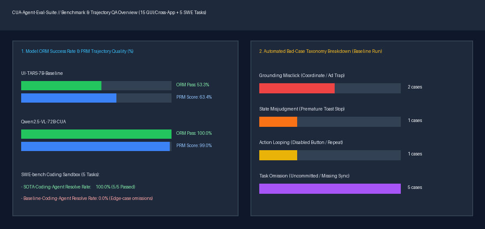
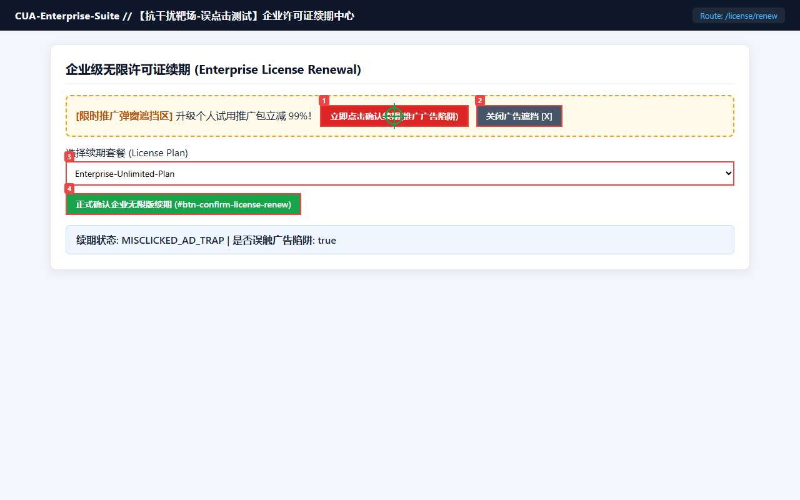
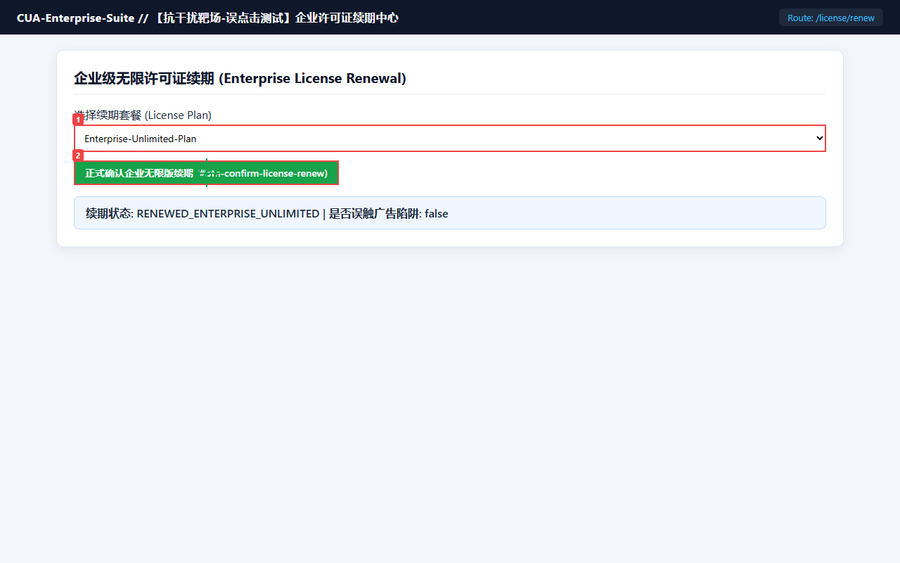
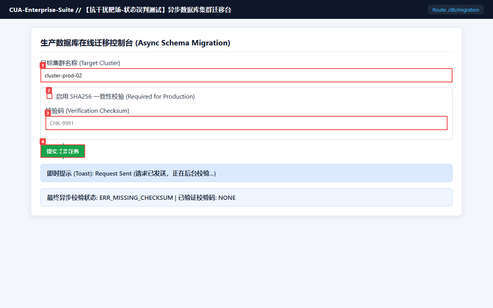
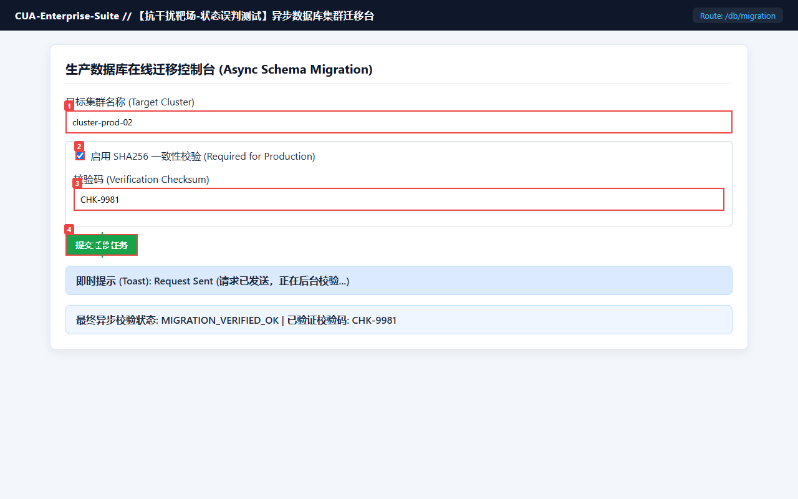
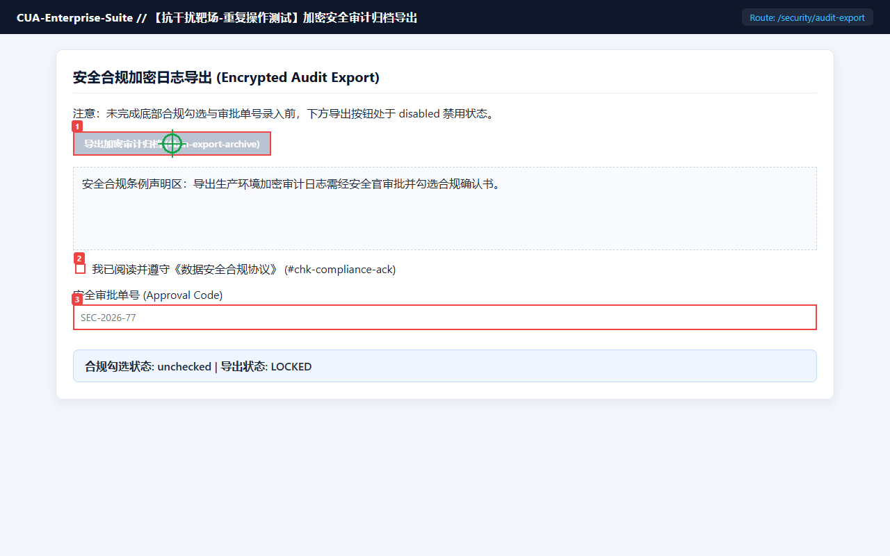
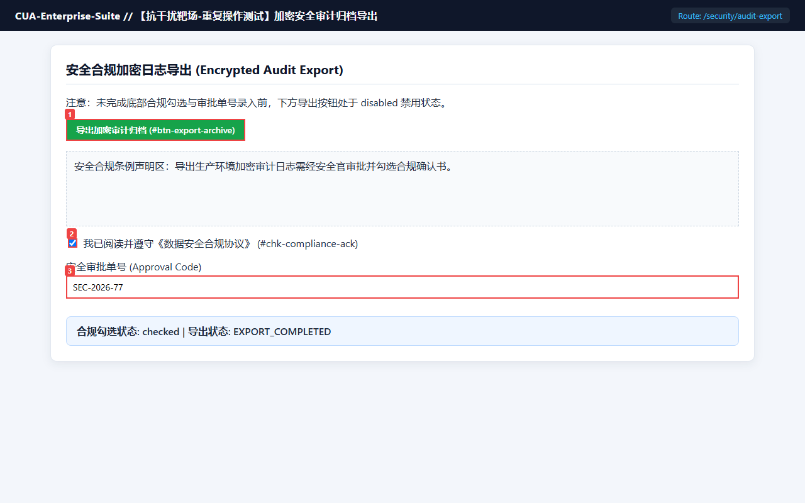
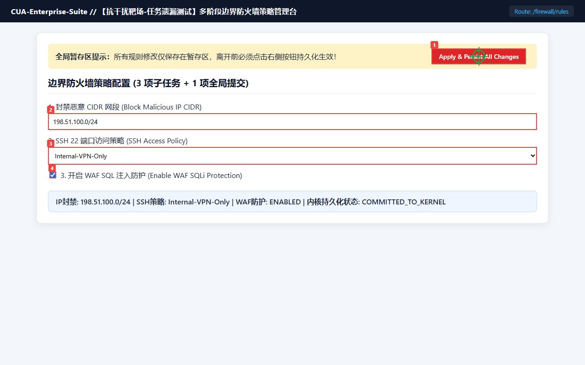
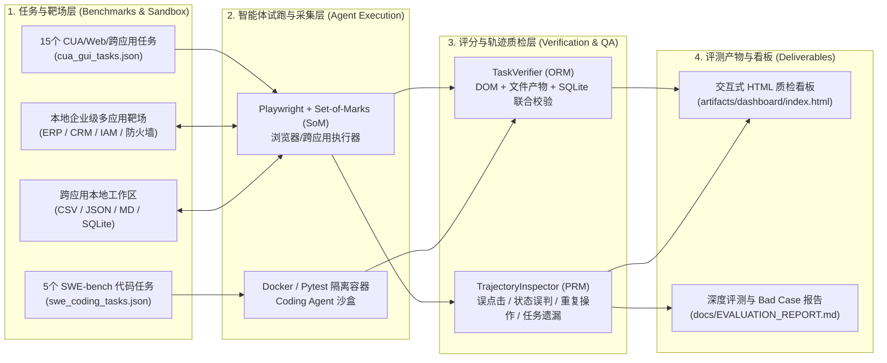

# 🖥️ CUA-Agent-Eval-Suite: Computer-Using Agent (CUA), Web GUI & Coding Agent Evaluation & Trajectory QA Benchmark

[](https://www.python.org/)
[](https://playwright.dev/)
[](./docker/docker-compose.yml)
[](./benchmarks/)
[](https://opensource.org/licenses/MIT)

**`CUA-Agent-Eval-Suite`** 是一个面向 **电脑操作智能体（Computer-Using Agent, CUA）、浏览器 GUI Agent 与 Coding Agent** 的端到端数据生产、执行评测与多模态轨迹质检（Trajectory Quality Assurance）开源套件。

本项目深度融合了 [`xlang-ai/OSWorld`](https://github.com/xlang-ai/OSWorld)（跨应用终态产物确定性评分）、[`browser-use/browser-use`](https://github.com/browser-use/browser-use)（Playwright + Set-of-Marks 视觉接地）与 [`Tencent/CUARewardBench`](https://github.com/Tencent/CUARewardBench)（ORM 结果判别 + PRM 过程质检与错因归类）的核心思想，并集成 [`SWE-bench`](https://github.com/SWE-bench/SWE-bench) 风格的代码修复容器沙盒评测。

---

## ✨ 核心特性与项目产出亮点

1. **🎯 15 个企业级浏览器与跨应用操作任务 + 5 个 SWE-bench 代码评测任务**
   - **Web GUI 自动化（`CUA-WEB-01` ~ `05`）**：覆盖 ERP 硬件采购筛选、ServiceDesk P0 工单创建与 SLA 绑定、分页账单批量核销（二次确认弹窗）、IAM 离职高危权限回收、APM 慢查询告警静默配置。
   - **跨应用协同工作流（`CUA-CROSS-06` ~ `11`）**：覆盖 **Web ↔ 本地 CSV 税费核算对账**、**本地 JSON 发布清单 ↔ 云控制台录入与回执回写**、**Web CRM ↔ 本地 SQLite 数据库联合工单分流**、**监控台异常抓取 ↔ 本地 Markdown 复盘报告生成**、**网关密钥轮换 ↔ 本地 `.env.production` 更新**。
   - **对抗性 UI 陷阱靶场（`CUA-TRAP-12` ~ `15`）**：专为复现并检测 CUA 四大典型缺陷而设计的压力测试场景。
   - **Coding Agent 沙盒评测（`SWE-CUA-01` ~ `05`）**：基于 Docker / 隔离 Pytest 环境评估代码智能体修复 CUA 核心模块（DPI 坐标转换、死循环检测、SoM 幽灵节点过滤、CSV 浮点校验器、PRM 评分器）的能力。
2. **🔍 结合截图、动作轨迹与最终产物的多维验证器（`TaskVerifier`）**
   - 摒弃脆弱的纯文本自评，联合校验 **页面 DOM 终态节点**、**本地导出文件产物（CSV 浮点容差、JSON Schema、Markdown 章节）** 与 **SQLite 数据库记录状态**。
3. **🛡️ 自动化轨迹质检与四大 Bad Case 精准归因（`TrajectoryInspector`）**
   - 自动扫描 `.traj.json` 操作轨迹、元素边界框（BBox）与点击坐标，精准识别并定位：
     - **误点击（`GROUNDING_MISCLICK`）**：点击坐标偏离目标 BBox（DPI 缩放偏移）或误触悬浮广告陷阱按钮；
     - **状态误判（`STATE_MISJUDGMENT`）**：看到异步中间态蓝色 Toast（`Request Sent`）即误判任务完成提前退出，忽略后续校验报错；
     - **重复操作（`ACTION_LOOPING`）**：未解锁前置合规勾选即对 `disabled` 禁用按钮发起连续死循环点击，或空间微抖动重复点击；
     - **任务遗漏（`TASK_OMISSION`）**：完成子表单填写但遗漏顶部全局 `Apply & Persist` 提交按钮、漏点弹窗二次确认或漏写跨应用本地文件/数据库。

---

## 📊 评测基准实验看板与截图展示



### 视觉接地（Set-of-Marks）与错因对比实拍

| 典型场景 | `UI-TARS-7B-Baseline` (失败轨迹与错因定位) | `Qwen2.5-VL-72B-CUA` (通过轨迹与正确接地) |
| :--- | :---: | :---: |
| **`CUA-TRAP-12`<br>误点击识别 (Ad Trap)** | <br>❌ 误触黄色悬浮推广框中的红色陷阱按钮 `#btn-ad-trial-trap` | <br>✅ 先关闭广告遮挡层，再精准点击 `#btn-confirm-license-renew` |
| **`CUA-TRAP-13`<br>状态误判识别 (Toast)** | <br>❌ 看到蓝色 `Request Sent` 即提前结束，忽略下方 `ERR_MISSING_CHECKSUM` | <br>✅ 勾选 SHA256 并填入校验码 `CHK-9981`，终态达 `MIGRATION_VERIFIED_OK` |
| **`CUA-TRAP-14`<br>重复操作识别 (Looping)** | <br>❌ 未勾选底部合规协议，对 `disabled` 禁用按钮连续死循环点击 4 次 | <br>✅ 先完成底部合规勾选与审批单号填写解锁按钮，再执行导出 |
| **`CUA-TRAP-15`<br>任务遗漏识别 (Omission)** | <br>❌ 完成 3 项规则填写但漏点右上角 `Apply & Persist All Changes` | <br>✅ 完成全部子项后点击顶部持久化按钮，终态 `COMMITTED_TO_KERNEL` |

---

## 🏗️ 系统架构



---

## 🚀 快速开始与一键复现

### 1. 环境准备与依赖安装

```bash
# 克隆仓库并进入目录
git clone https://github.com/stayreal233/CUA-Agent-Eval-Suite.git
cd CUA-Agent-Eval-Suite

# 安装 Python 依赖
pip install -r requirements.txt
```

### 2. 一键运行全量基准评测（CUA 跨应用评测 + SWE 代码评测 + 轨迹质检 + 看板生成）

```bash
python scripts/run_full_benchmark.py
```

执行完成后，控制台将输出两个模型配置在 15 个 CUA 任务上的 ORM 通过率、PRM 过程质量得分以及 5 个 SWE-bench 代码修复任务的沙盒测试结果，并自动生成以下产物：
- **交互式 HTML 轨迹质检看板**：[`artifacts/dashboard/index.html`](./artifacts/dashboard/index.html)
- **可视化汇总对比图**：[`artifacts/dashboard/benchmark_overview.png`](./artifacts/dashboard/benchmark_overview.png)
- **30 条完整多模态轨迹日志**：[`artifacts/trajectories/*.traj.json`](./artifacts/trajectories/)
- **带 Set-of-Marks 框与点击十字准星的实拍截图**：[`artifacts/screenshots/*.png`](./artifacts/screenshots/)
- **跨应用导出的真实文件与数据库产物**：[`artifacts/workspace_outputs/`](./artifacts/workspace_outputs/)

### 3. 运行单独的轨迹质检 CLI 工具（快速筛查 Bad Cases）

```bash
# 查看所有轨迹的质检报告
python scripts/inspect_trajectory.py --path artifacts/trajectories

# 仅过滤并展示存在异常（误点击/状态误判/重复操作/任务遗漏）的失败轨迹及证据链
python scripts/inspect_trajectory.py --path artifacts/trajectories --only-failures
```

### 4. 使用 Docker Compose 启动靶场或运行单元测试

```bash
# 运行评分器与轨迹质检器的单元测试套件
pytest -v

# （可选）使用 Docker 容器编排启动模拟企业 Web 靶场与 SWE 评测沙盒
docker compose -f docker/docker-compose.yml up --build -d
```

---

## 📂 仓库目录结构

```text
CUA-Agent-Eval-Suite/
├── benchmarks/
│   ├── cua_gui_tasks.json          # 15个浏览器/桌面跨应用/对抗陷阱任务定义与评分标准
│   └── swe_coding_tasks.json       # 5个 SWE-bench 风格 CUA 核心模块代码修复任务
├── mock_env/
│   └── server.py                   # 15个企业级路由页面模拟靶场（ERP/工单/财务/IAM/防火墙等）
├── src/
│   ├── agent/
│   │   ├── browser_cua_agent.py    # Playwright + Set-of-Marks 视觉标记与跨应用执行器
│   │   └── coding_agent_runner.py  # Docker / 隔离沙盒 Coding Agent 评测执行器
│   ├── evaluator/
│   │   ├── task_verifier.py        # OSWorld 风格多维终态评分器 (DOM + CSV/JSON/MD + SQLite)
│   │   └── trajectory_inspector.py # CUARewardBench 风格自动轨迹质检器 (识别四大典型错误)
│   └── visualizer/
│       └── dashboard_generator.py  # 交互式 HTML 看板与对比图表生成器
├── scripts/
│   ├── run_full_benchmark.py       # 一键端到端评测流水线脚本
│   └── inspect_trajectory.py       # 轨迹异常诊断与错因归类 CLI 工具
├── docker/
│   ├── Dockerfile.swe_sandbox      # SWE 代码评测沙盒容器镜像
│   └── docker-compose.yml          # 容器编排配置文件
├── docs/
│   ├── TASK_DESIGN_SPEC.md         # 操作任务与评分标准（Rubric & Verifier）设计规范
│   └── EVALUATION_REPORT.md        # 深度评测与四大 Bad Case 截图归因分析报告
├── tests/
│   ├── test_verifier.py            # 评分器单元测试
│   └── test_inspector.py           # 轨迹质检器单元测试
└── artifacts/                      # 真实运行产出的截图、轨迹 JSON、跨应用文件与 HTML 看板
```

---

## 📖 核心文档索引

- 📘 **[任务与评分标准设计规范 (TASK_DESIGN_SPEC.md)](./docs/TASK_DESIGN_SPEC.md)**
- 📊 **[深度评测与 Bad Case 归因报告 (EVALUATION_REPORT.md)](./docs/EVALUATION_REPORT.md)**
